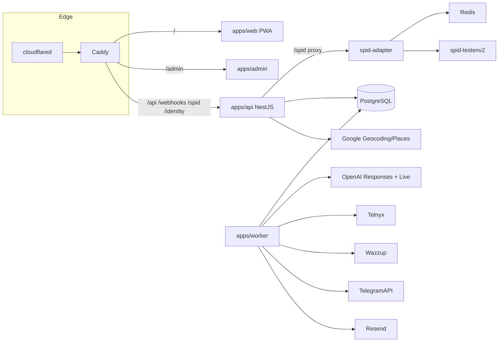
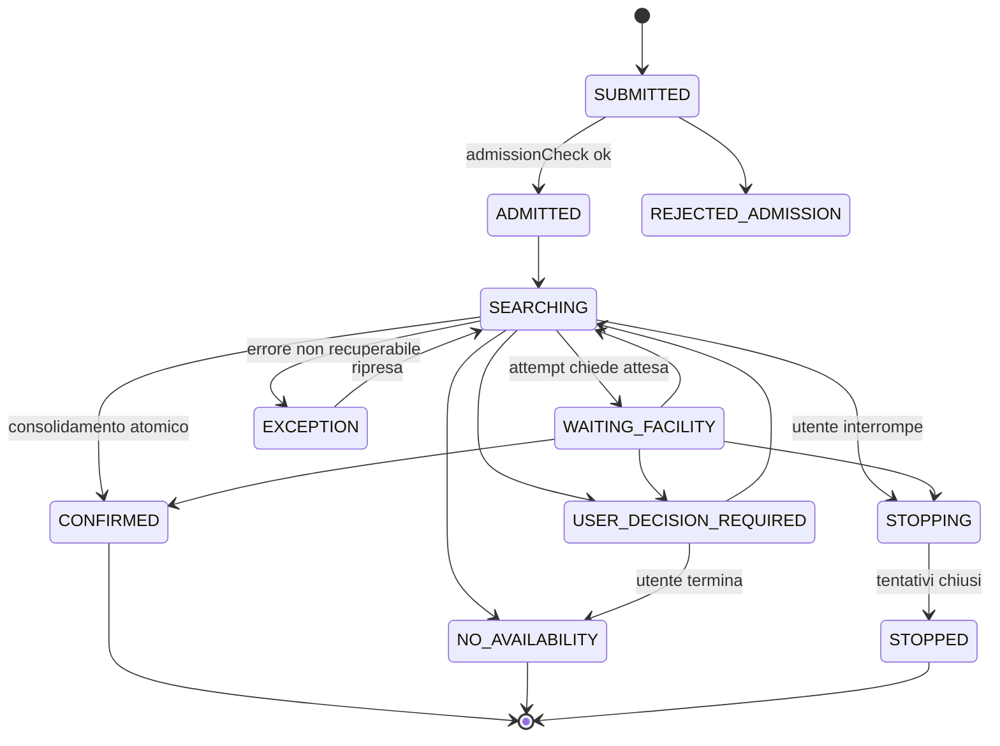

# Piano master C'èCampo

**Stato:** specifica consolidata di implementazione. I piani Grocco originali sono in `docs/archivio/`. Questo documento è la fonte unica.


# Piano master C'èCampo (brand variabile, powered by Digital Mop)

## 0. Decisioni prese (vincolanti per chi implementa)

- **Stack**: Node 22, pnpm workspaces, TypeScript strict ovunque. Backend **NestJS**, DB **PostgreSQL 16** (+ estensioni `btree_gist`, `pgcrypto`, `earthdistance`/`cube`), ORM **Drizzle** (schema TS, migrazioni SQL in `apps/api/drizzle/`), frontend **Angular** (standalone, signals, SCSS custom senza Material; Angular CDK per dialog/drag), validazione con **zod** in `packages/shared` (riusata da API via `nestjs-zod` e da Angular).
- **Niente Redis per code**: job, scheduler, inbox webhook e outbox eventi stanno in Postgres (`SELECT ... FOR UPDATE SKIP LOCKED`). Redis resta solo perché lo richiede `spid-express`.
- **Un solo host** `campi.brugno.it` con path routing (Caddy): `/` PWA utente, `/admin/` app admin, `/api/*` API, `/webhooks/*`, `/spid/*`, `/identity/*` API (path già configurati nei provider: **non cambiarli**). `/internal/*` e `/demo/*` bloccati da Caddy verso l'esterno.
- **Vincono le patch più recenti**: crediti senza abbonamenti né Pass; nessun budget per richiesta (ammissione + completamento garantito + overage assorbito); telefono solo verso strutture (nessuna chiamata al cliente); contatti struttura whitelisted senza account.
- Tipologie campo **5, 7, 8, 9, 11** (enum configurabile da admin). Form: data, ora esatta, 90' fissi, tipologia, Indoor/Outdoor, posizione, **solo raggio massimo**, lista campi con include/escludi e ordinamento.
- Identità v1: email+password, OTP email (Resend), OTP SMS (Telnyx), **SPID testenv**. Google/passkey/CIE: fasi successive, schema già predisposto (`auth_identities` multi-provider).
- Admin con **TOTP obbligatorio**. Ricarica crediti **manuale da admin** (Stripe dopo, dietro interfaccia `PaymentProvider`).
- Geocoding **Google Maps** (Geocoding API + Places API (New) Autocomplete con session token) dietro interfaccia `GeocodingProvider`; implementazione `photon` come fallback dietro `GEOCODING_PROVIDER=google|photon`. Distanza in linea d'aria. **Chiave già creata** (progetto GCP "Maps Platform Demo Project"): va in `server/.env` come `GOOGLE_MAPS_API_KEY` (mai nel repo, mai nel bundle Angular). Tutte le chiamate Google passano dal backend (`GET /api/geo/autocomplete?q&sessionToken`, `GET /api/geo/place/:id`, `GET /api/geo/geocode?address`) con rate limit per utente e cache 24h in Postgres (`geo_cache`); così una sola chiave server-side, restretta in GCP a "API: Geocoding API, Places API (New)" e, in prod, all'IP del VPS. Impostare budget alert GCP a 10 €.
- Score: regole deterministiche + LLM judge opzionale + revisione umana in admin.
- Lingua: solo italiano, i18n Angular predisposto.
- Brand via env (`BRAND_SERVICE_NAME`, `BRAND_COMPANY_NAME`, `BRAND_TAGLINE`, `BRAND_POWERED_BY`), esposto da `GET /api/public/config` e `GET /api/public/manifest.webmanifest`, usato in UI, prompt AI, email, messaggi bot. **Mai hardcodare "Digital Mop" o "C'èCampo" nel codice.**
- CI GitHub Actions: lint + test + build immagini a ogni push.

## 1. Layout del repository

```
apps/api            NestJS (HTTP + webhooks)              -> immagine ce-campo-api
apps/worker         stesso codice, entry `worker.main.ts`  -> stessa immagine, comando diverso
apps/web            Angular PWA utente                      -> immagine statica (Caddy file_server)
apps/admin          Angular admin (base-href /admin/)       -> immagine statica
apps/scenario-runner CLI stress/demo (scenari JSON)
packages/shared     zod schemas, enum, tipi DTO, codici finding, costanti brand
packages/domain     logica pura testabile (state machine, regole score, calcolo finestre, prezzi)
spid-adapter/       già presente: parametrizzare host hardcoded (BACKEND_INTERNAL_URL, PUBLIC_BASE_URL), tracciare in git (escludere certs/)
infra/caddy/Caddyfile.demo, Caddyfile.prod
infra/cloudflared/config.yml
docker-compose.yml (demo), docker-compose.prod.yml
docs/00-piano-master.md (questo piano consolidato) + docs/archivio/ (i 9 MD attuali)
```

Il codice Express attuale (`server/`) viene **portato** in `apps/api` modulo per modulo e poi rimosso; nessun pezzo funzionante va riscritto se può essere incapsulato (es. `live-call-session.js` diventa `LiveCallSessionService` quasi identico, tipizzato).

## 2. Architettura



Regola architetturale: **webhook e HTTP scrivono solo in inbox/outbox e tabelle di dominio; tutto ciò che è lento o esterno (OpenAI, Telnyx, Wazzup, Telegram, Resend, push) lo esegue il worker leggendo job da Postgres.** L'AI propone azioni tramite tool; il backend (`packages/domain` + servizi Nest) decide e persiste.

## 3. Infrastruttura demo e prod

**docker-compose.yml (demo)**: `caddy` (80, legge `Caddyfile.demo`), `cloudflared` (token tunnel in `.env`, ingress `campi.brugno.it -> http://caddy:80`), `postgres` (volume), `api`, `worker`, `web`, `admin`, `spid-express-app`, `spid-testenv2`, `redis`. Healthcheck su `api` (`GET /api/health` verifica DB). `api` e `worker` montano lo stesso `.env`.

**docker-compose.prod.yml**: come sopra senza `cloudflared`/`spid-testenv2`, Caddy con TLS automatico sul dominio prod, `restart: always`, backup giornaliero Postgres (`pg_dump` in container cron su volume), log JSON. `NODE_ENV=production` fa fallire l'avvio se mancano segreti o se `DEMO_*` sono attivi.

**Caddyfile** (identico tra demo/prod salvo TLS): `handle_path /admin/*` -> `admin:80`; `handle /api/* /webhooks/* /spid/* /identity/*` -> `api:3000`; `respond /internal/* 404`; `respond /demo/* 404` (solo prod); `handle` -> `web:80`. Le app Angular sono servite da Caddy con `try_files {path} /index.html`.

**.env.example** aggiornato con tutte le variabili (brand, DB, tunnel, Google, VAPID, flag crediti/reporting/score). Script `pnpm demo:up`, `pnpm demo:logs`, `pnpm demo:seed`, `pnpm prod:deploy` (ssh + compose pull/up) documentati in `docs/runbook.md`.

## 4. Modello dati (Postgres) — nomi definitivi

Convenzioni: `id uuid default gen_random_uuid()`, `created_at/updated_at timestamptz`, soldi in centesimi `bigint`, crediti `integer`, timestamp UTC, fuso visualizzazione `Europe/Rome`. Ogni tabella con stato ha `version integer` per optimistic locking.

**Identità e accesso**
- `users` (email, email_verified_at, phone_e164, phone_verified_at, status, locale)
- `auth_identities` (user_id, provider `password|google|passkey`, provider_key, secret_hash) — unique (provider, provider_key)
- `verified_identities` (user_id unique, method `spid|cie`, identity_key = HMAC(fiscalNumber), verified_at) — unique su identity_key: una persona, un account
- `sessions` (user_id, token_hash, expires_at, revoked_at, csrf_secret)
- `otp_codes` (purpose `email|phone`, target, code_hash, expires_at, attempts, used_at)
- `spid_handoffs` (pending_token_hash, result_token_hash, payload cifrato, expires_at)
- `channel_links` (user_id, provider `telegram|whatsapp`, channel_id, external_user_id, chat_id, status) — unique parziali su status='active' per (provider,user_id) e (provider,channel_id,external_user_id)
- `channel_link_requests` (user_id, provider, token_hash, status `pending|claimed|completed|expired|cancelled`, claimed_external_user_id, expires_at)
- `admin_users` (email, password_hash, totp_secret_enc, status), `admin_sessions`, `admin_audit_logs` (admin_id, entity_type, entity_id, action, diff jsonb, correlation_id)

**Strutture**
- `structures` (name, address jsonb, location geography-like via `point` + earthdistance, timezone, status `draft|active|suspended|archived`, cancellation_free_window_minutes, notes_internal, version)
- `fields` (structure_id, name, football_type smallint in (5,7,8,9,11), environment `indoor|outdoor`, surface, price_90_cents, currency, status)
- `structure_contacts` (structure_id, channel `phone|whatsapp|sms|email|telegram`, destination, priority, enabled, authorized, inbound_enabled, outbound_enabled, verification_status, weekly_windows jsonb, exceptions jsonb, source, revoked_at) — unique (structure_id, priority) where enabled
- `structure_contact_bindings` (contact_id, provider, channel_id, external_actor_id, verified_at, status) — whitelist in ingresso (sostituisce `config/structure-contacts.json`)
- `structure_link_tokens` (contact_id, token_hash, expires_at, used_at) — QR Telegram porta a porta

**Prenotazioni**
- `booking_requests` (user_id, status, match_date, start_at, end_at, football_type, environment, origin_point, radius_km, snapshot jsonb {criteri, lista ordinata campi, esclusioni, prezzi}, idempotency_key unique, admission jsonb, terminal_reason, closed_at, version)
- `booking_attempts` (request_id, structure_id, field_id, rank, status, contact_channel, callback_due_at, counter_offer jsonb, result jsonb, closed_reason, version)
- `slot_holds` (field_id, request_id, attempt_id, period tstzrange, status `active|released|converted`, expires_at) — **`EXCLUDE USING gist (field_id WITH =, period WITH &&) WHERE (status='active')`**
- `bookings` (request_id unique, user_id, structure_id, field_id, start_at, end_at, price_cents snapshot, cancellation_free_window_minutes snapshot, confirmation jsonb {source, at, attempt_id}, status `confirmed|cancelling|cancelled|replaced|disputed`)
- `user_decisions` (request_id, attempt_id, question_type, question_payload, options, expires_at, answer, answered_at, answered_via) — ogni domanda all'utente ha id; risposta idempotente
- `availability_observations` (field_id, period, state `unknown|free_observed|busy_observed|held|booked|unreliable`, source, observed_at, valid_until, attempt_id)
- `cancellations` (booking_id, requested_at, reason_text, on_time boolean, recovery_state `NOT_REQUIRED|PENDING|SUCCEEDED|FAILED|UNKNOWN`, structure_outcome jsonb)
- `replacement_offers` (cancellation_id, candidate_request_id, status, expires_at)
- `domain_events` (aggregate_type, aggregate_id, request_id, type, payload jsonb minimizzato, idempotency_key unique, occurred_at) — fonte della timeline e dello score
- `outbox` (event_id, handler, status, attempts, next_at) ; `jobs` (type, payload, run_at, locked_at, attempts, last_error, dedupe_key unique) ; `webhook_inbox` (provider, external_id unique per provider, payload, status)
- `notifications` (user_id, request_id, kind `info|decision`, channel, payload, sent_at, delivered_at, error) ; `push_subscriptions`

**AI / conversazioni / telefonia**
- `conversations` (user_id or contact_id, actor_type, channel, external_conversation_id, openai_conversation_id, request_id nullable, status) — serializzazione turni via `jobs` con dedupe per conversation
- `agent_runs` (request_id, conversation_id, trigger, model, instructions_version, tools_version, status)
- `agent_tool_calls` (run_id, tool_name, args jsonb minimizzato, result_status, duration_ms, rejected_reason)
- `agent_output_logs` (run_id, text_sanitized, sanitization_status, expires_at)
- `calls` (attempt_id, direction, live_session_id unique, caller/callee ref, answered_at, ended_at, end_reason, usage jsonb, screening_result)

**Crediti e consumi**
- `wallets` (user_id unique, available, held)
- `credit_ledger` (wallet_id, type `initial_bonus|topup|usage_charge|guarantee_hold|guarantee_release|penalty|adjustment`, amount signed, request_id/booking_id, idempotency_key unique, policy_version, created_by)
- `usage_records` (request_id, run_id/call_id, provider, unit_type, quantity, status `estimated|reported|reconciled`, attribution `user|platform`, source_ref)
- `provider_price_versions`, `cost_records` (usage_id, cost_micros, price_version)
- `credit_policy_versions` (json regole conversione, effective_from) ; `request_settlements` (request_id, actual_credits, charged_credits, platform_absorbed_credits)
- `booking_guarantees` (booking_id, amount, status `HELD|RELEASE_PENDING|RELEASED|FORFEITED|DISPUTED|EXPIRED`)
- `reliability_events` (user_id, type, booking_id)

**Score e reportistica**
- `score_policy_versions` (json: pesi dimensioni, penalità per finding code, soglie)
- `request_scores` (request_id unique, policy_version, total 0-100, dims jsonb {ai_quality, user_friction, efficiency, reliability, outcome, structure_behaviour}, computed_at, stale boolean)
- `score_findings` (request_id, code, dimension, severity `info|minor|major|critical`, source `rule|llm_judge|human`, evidence_event_ids uuid[], confidence, note_sanitized)
- `score_reviews` (request_id, admin_id, override_total nullable, reason, created_at)
- `test_sessions` (scenario_name, dataset_version, config jsonb, concurrency, providers_mode `simulated|real`, expected jsonb, observed jsonb, completeness) — collega le richieste create dal runner via `booking_requests.test_session_id`

## 5. Macchine a stati (packages/domain, funzioni pure + test)



Tentativo: `QUEUED -> CONTACTING -> (WAITING_FACILITY -> CALLBACK_DUE -> CONTACTING)* -> USER_DECISION_REQUIRED | REJECTED | CONFIRMED_WINNER | CLOSING -> CLOSED | FAILED`. Transizioni valide in una tabella `ALLOWED_TRANSITIONS` esportata e testata; ogni transizione produce un `domain_event` nella stessa transazione.

Regole non negoziabili codificate in `packages/domain/booking/rules.ts`: orario esatto, 90', snapshot immutabile, una sola `bookings` per request (unique), hold atomico via exclusion constraint, prima conferma valida vince, vincitore mai cambiato dopo consolidamento, doppia conferma esterna -> `bookings.status='disputed'` + job compensazione + notifica admin, decisione utente valida solo se `user_decisions.expires_at` non scaduto e `answered_at is null`, nessun timeout funzionale fisso sull'attesa: `callback_due_at` dalla struttura + `HOLD_SAFETY_TTL_MINUTES` tecnico configurabile per riconciliazione.

## 6. Moduli NestJS (`apps/api/src/modules/`)

`config` (zod su env, brand) · `health` · `public` (config, manifest) · `auth` (registrazione, login, sessioni cookie HttpOnly + CSRF double-submit, OTP email/SMS) · `identity` (SPID handoff: porta `/identity/spid/*` e `/internal/identity/spid` così come sono) · `channels` (link Telegram/WhatsApp con conferma PWA, webhook inbox) · `structures` (CRUD admin, directory per agente, contact selection con finestre e TZ, whitelist bindings) · `booking` (requests, attempts, holds, decisions, consolidation, cancellations, recovery) · `wallet` (ledger, admission, settlement, guarantees) · `metering` (usage, prices, costs) · `ai` (orchestrator, tools registry, prompt versions, sanitizer, judge) · `telephony` (OpenAI Live attach, Telnyx, screening, inbound gate) · `notifications` (in-app, push, canali) · `reporting` (query aggregate, export CSV) · `scoring` (rules engine, judge, reviews) · `admin-auth` (TOTP) · `testing` (test_sessions, endpoint seed/scenario solo se `DEMO_ENABLED=true`).

Worker (`apps/worker`): un unico loop `JobRunner` che prende job con `SKIP LOCKED`, handler per tipo: `outbox.dispatch`, `agent.turn`, `attempt.contact`, `attempt.callback_due`, `hold.reconcile`, `call.outbound`, `notify.send`, `usage.reconcile`, `score.compute`, `judge.run`, `retention.purge`. Idempotenza: ogni handler controlla `dedupe_key` e stato corrente prima di agire. Riavvio sicuro: job in `locked_at` più vecchi di `JOB_LOCK_TTL` tornano disponibili.

## 7. Orchestratore AI e tool

- Un solo orchestratore (`AiOrchestratorService`, porting di `ai-orchestrator.js`) con registro tool popolato. Contesto costruito **dal backend**: `{actorType: 'customer'|'structure_contact', userId|contactId, channel, conversationId, requestId?, attemptId?, structureIds?}`. Il modello non può cambiare actorType o scope.
- Tool cliente (ogni tool chiama un servizio che rifà tutti i controlli): `get_my_requests`, `get_request_detail`, `create_booking_request` (restituisce riepilogo e richiede `confirm_booking_request` separato), `answer_decision(decisionId, answer)`, `stop_request`, `request_cancellation(bookingId, reason)`, `get_wallet`.
- Tool struttura (via WhatsApp/Telegram/telefono): `list_open_attempts_for_me`, `report_availability(attemptId, outcome: available|unavailable|wait{minutes}|counter_offer{start})`, `confirm_booking(attemptId)`, `report_cancellation_outcome`. Se più tentativi aperti e messaggio ambiguo -> tool `ask_which_attempt` prima di qualsiasi scrittura.
- Telefonia: `buildLiveSession` esteso con `direction`, `structureName`, `attemptContext`; i backend tools della delega diventano gli stessi tool struttura + `end_call`. Inbound: gate su `structure_contact_bindings` (porting di `openai-live.js`) prima di `accept`. Outbound: job `call.outbound` crea sessione (porting `test-call.js`) solo dentro finestra di reperibilità del contatto scelto.
- Adapter **`SimulatedStructureChannel`**: implementa la stessa interfaccia `StructureChannel` (`contact(attempt) -> Promise<void>` + eventi asincroni) ma risponde secondo uno script per struttura (`available_now`, `unavailable`, `wait:15m then confirm`, `wait then no_answer`, `counter_offer:+60m`, `double_confirm`). Scelta via `structures.simulation_profile` (solo demo).
- Prompt versionati in `apps/api/src/modules/ai/prompts/<name>.v<N>.ts`; `instructions_version` salvato su `agent_runs`.
- Sanitizer: prima di persistere testo agente, sostituisce dati noti nel contesto (nomi, telefoni, email, codici) con placeholder; se regex PII residue -> `sanitization_status='omitted'`.
- Guardrail anti-loop: `MAX_TOOL_ROUNDS`, `MAX_ATTEMPTS_PER_REQUEST_OPEN`, `MAX_CONTACTS_PER_STRUCTURE_PER_REQUEST`, tool rifiutati loggati in `agent_tool_calls.rejected_reason` (alimentano lo score).

## 8. Crediti (modello patch "completamento garantito")

- Alla verifica email: `initial_bonus` di `INITIAL_FREE_CREDITS` una sola volta per utente/wallet (`idempotency_key = initial_bonus:user:{userId}`). Chi ha già un `initial_bonus` (grant precedente via identità) non ne riceve un secondo. Più account email possono ricevere ciascuno un bonus; lo SPID non è più l'antifarm del grant.
- Ammissione (`CREDIT_ADMISSION_CHECK_ENABLED`): identità verificata, telefono verificato, `available > 0`, nessuna richiesta attiva se `MAX_ACTIVE_REQUESTS_PER_USER=1`, `available >= estimate_p50` solo quando `CREDIT_ESTIMATION_ENABLED` (calibrato dai dati).
- Durante l'esecuzione: `usage_records` -> `cost_records` -> conversione in crediti via `credit_policy_versions` (fissata all'apertura della richiesta) -> addebito progressivo `min(available, delta)`; eccedenza in `request_settlements.platform_absorbed_credits`. Mai saldo negativo, mai tocca `held`.
- Garanzia alla conferma: `guarantee_hold` di `GUARANTEE_CREDITS` (policy), rilascio/penale secondo `cancellations` (on_time usa `requested_at` vs `start_at - window`); `RECOVERY_UNKNOWN` non applica penale, apre caso admin.
- Admin: `POST /api/admin/wallets/:userId/adjustments` con causale obbligatoria, audit.

## 9. Sistema di score (punti deboli per ogni richiesta conclusa)

**Quando**: job `score.compute` a ogni stato terminale di `booking_requests`, ricalcolo (`stale=true`) se arrivano eventi tardivi; anche su richieste del runner (`test_session_id`).

**Input**: `domain_events`, `agent_runs`, `agent_tool_calls`, `agent_output_logs`, `usage_records`, `user_decisions`, `notifications`, `calls`, `request_settlements`.

**Regole deterministiche** (`packages/domain/scoring/rules/*.ts`, una per file, firma `(ctx) => Finding[]`, tutte con test). Catalogo iniziale dei `code` (estendibile, in `packages/shared/finding-codes.ts`):
- ai_quality: `AI_TOOL_REJECTED`, `AI_TOOL_UNKNOWN`, `AI_LOOP_LIMIT`, `AI_CLAIM_WITHOUT_EVENT` (testo bonificato contiene pattern "prenotato/confermato" senza `booking.confirmed`), `AI_MISSING_END_CALL`, `AI_SCREENING_UNCERTAIN`, `AI_CONTACT_OUT_OF_WINDOW_ATTEMPTED`, `AI_SANITIZATION_OMITTED`, `AI_EMPTY_RESPONSE`, `AI_LATENCY_P95_HIGH`
- user_friction: `UX_DECISIONS_COUNT_HIGH`, `UX_DECISION_EXPIRED_UNANSWERED`, `UX_DUPLICATE_NOTIFICATION`, `UX_TIME_IN_DECISION_HIGH`, `UX_NOTIFICATION_FAILED`
- efficiency: `EFF_ATTEMPTS_HIGH`, `EFF_RETRIES_HIGH`, `EFF_CALLBACK_MISSED_BY_US`, `EFF_COST_OVER_ESTIMATE`, `EFF_TIME_TO_CONFIRM_HIGH`, `EFF_WAIT_TIME_HIGH`
- reliability: `REL_WEBHOOK_DUPLICATE`, `REL_HOLD_ORPHANED`, `REL_RECONCILIATION_OPENED`, `REL_EXCEPTION_RAISED`, `REL_RESUMED_AFTER_ERROR`, `REL_USAGE_MISSING`, `REL_JOB_RETRIES_HIGH`, `REL_DOUBLE_EXTERNAL_CONFIRMATION`
- outcome: `OUT_CONFIRMED`, `OUT_NO_AVAILABILITY`, `OUT_STOPPED_BY_USER`, `OUT_PROBLEM_UNRESOLVED`, `OUT_LEFT_OPEN` (nessuno stato terminale oltre `REQUEST_OPEN_ALERT_HOURS`)
- structure_behaviour: `STR_NO_ANSWER`, `STR_CALLBACK_NOT_HONOURED`, `STR_PRICE_MISMATCH`, `STR_COUNTER_OFFER`, `STR_LATE_CONFIRMATION`, `STR_CONTACT_UNUSABLE`
Ogni finding ha `severity`, `evidence_event_ids`, `dimension`. Il totale: 100 meno penalità per severità (pesi in `score_policy_versions.v1`), sotto-score per dimensione; `outcome` pesa come moltiplicatore, non azzera gli altri (una "Nessuna disponibilità" pulita può avere score alto).

**LLM judge** (`SCORE_LLM_JUDGE_ENABLED`, modello `OPENAI_JUDGE_MODEL`): riceve solo timeline eventi + testi bonificati, restituisce JSON `{findings:[{code in catalogo o JUDGE_OTHER, severity, confidence, note}]}`; salvato con `source='llm_judge'`; costo registrato come `usage_records.attribution='platform'`; non modifica i finding da regola.

**Revisione umana**: in admin, scheda richiesta -> tab "Score": punteggio, dimensioni, finding con link agli eventi, pulsanti "Aggiungi finding", "Override totale (motivo)", "Segna falso positivo". Tutto in `score_reviews`/`score_findings(source='human')`.

**Vista "Cosa sistemare"** (`GET /api/admin/reports/weak-points?from&to&env&test_session`): finding aggregati per code con conteggio, trend vs periodo precedente, % richieste coinvolte, 5 richieste esempio, raggruppamento per `instructions_version` e `tools_version` così si vede se una modifica al prompt ha peggiorato un code. È la pagina principale della reportistica admin.

## 10. Reportistica (admin)

Endpoint sotto `/api/admin/reports/*`: `overview` (incarichi per stato, costo diretto, quota stimata, crediti calcolati/addebitati/assorbiti, p50/p90 costo, tentativi medi, tempo attivo vs trascorso, errori, riconciliazioni aperte, **richieste senza esito terminale**), `requests` (lista filtrabile, paginata server-side), `requests/:id` (timeline, tentativi, consumi drill-down, score), `requests/:id/events`, `requests/:id/usage`, `weak-points`, `structures` (tasso successo per canale, richiami mancati, raggiungibilità), `reconciliation`, `test-sessions` e `test-sessions/:id` (confronto atteso/osservato, costi, score medio), `exports` (CSV minimizzato, formule neutralizzate). Filtri comuni: periodo, ambiente, `test_session`, canale, modello, versione istruzioni, esito, completezza. Ogni tasso espone numeratore e denominatore.

Retention (job `retention.purge`): `AGENT_OUTPUT_RETENTION_DAYS=30`, `AGENT_EVENT_RETENTION_DAYS=90`; ledger e settlement non si cancellano.

## 11. Frontend

**apps/web (PWA)**: design del mockup (palette beige/verde, bottom nav Prenota / Storico / Account), ma struttura reale: `core/` (ApiClient con credenziali cookie + header CSRF, BrandService da `/api/public/config`, AuthGuard, RequirementsGuard che reindirizza al wizard verifiche), `features/`: `auth` (registrazione, login, OTP email, OTP telefono), `verify` (wizard: email/telefono/SPID con ritorno al percorso), `booking/new` (form + lista campi con checkbox e frecce + riepilogo + ammissione + "Affida la ricerca"), `requests` (lista raggruppata In corso / Da gestire / Confermate / Storico), `request-detail` (stato UX, timeline da eventi, tentativi, card decisione: Aspettiamo / Prosegui, controproposta, nessuna disponibilità, interrompi), `booking-detail` (ticket, condizioni, Richiedi disdetta), `cancellation`, `opportunity`, `wallet`, `account` (profilo, identità e sicurezza, canali collegati con flusso link+conferma, fatturazione dati), `notifications` (SSE `GET /api/me/events/stream` + Web Push). Stati UX mappati da `packages/shared/ux-status.ts` (unica funzione `toUxStatus(request, attempts)`). Service worker Angular + manifest dinamico. Prefill ultima richiesta lato server (`GET /api/me/booking-defaults`).

**apps/admin**: login + TOTP, dashboard strutture, wizard struttura (anagrafica, campi, contatti, reperibilità con editor settimanale ed eccezioni, disdetta, riepilogo attivazione con errori bloccanti), scheda struttura a sezioni (incl. disponibilità rilevate, contatti autorizzati con QR Telegram, audit), utenti e wallet (adjustment), reportistica (overview, richieste, dettaglio con score e revisione, cosa sistemare, strutture, riconciliazione, sessioni di test, export), configurazione (versioni prezzi provider, policy crediti, policy score — creazione nuova versione, mai modifica).

## 12. Scenario runner e stress test

`apps/scenario-runner`: legge `scenarios/*.json` (`{name, users:[...], structures:[{simulation_profile}], requests:[{user, when, criteria}], userDecisions:[{on:'wait_question', answer:'wait'}], concurrency, expected:{terminalStatus, bookingsCount, holdsConflicts:0}}`), chiama API con header `X-Demo-Secret` (solo `DEMO_ENABLED`), crea `test_sessions`, attende stati terminali, confronta con `expected`, stampa report e lascia tutto consultabile in admin. Scenari obbligatori: i 12 del piano booking + i 14 del piano reportistica + `budget_overage`, `restart_mid_request` (il runner riavvia il container worker a metà), `duplicate_webhooks`, `double_external_confirmation`.

## 13. Fasi di implementazione (ognuna termina con criteri verificabili)

**Fase 0 — Fondazioni** · monorepo pnpm, Nest skeleton, Angular skeleton x2, Drizzle + migrazione iniziale, compose demo con Caddy+cloudflared, brand config, CI, `docs/00-piano-master.md`, archivio MD. Porting 1:1 di webhook Telegram/Wazzup/OpenAI Live, OTP email, SPID handoff, script call (ancora con store in memoria dietro interfacce `*Store`). **Accettazione**: tunnel attivo, `GET https://campi.brugno.it/api/health` ok, bot Telegram e WhatsApp rispondono come oggi, chiamata inbound dal tuo cellulare accettata, SPID testenv completa il giro.

**Fase 1 — Account e canali persistenti** · users/sessions/CSRF, registrazione, OTP email/SMS persistenti, SPID -> `verified_identities`, link Telegram/WhatsApp produzione (pending/claimed/confirm), whitelist strutture in DB con seed idempotente, inbox webhook idempotente, conversazioni persistenti, PWA: auth + wizard verifiche + canali. **Accettazione**: scenari 1–7, 13 del piano onboarding; riavvio container senza perdita link.

**Fase 2 — Admin strutture** · admin auth + TOTP, CRUD strutture/campi/contatti/finestre/disdetta, validazione attivazione, audit, directory per agente (`findCandidates(point, radius, type, env)`, `selectContact(structure, now)`), app admin. **Accettazione**: scenario end-to-end sezione 21 del piano admin fino al punto 11 (chiamata fuori fascia bloccata).

**Fase 3 — Motore prenotazioni + wallet base + PWA prenotazione** · domain state machines, requests/attempts/holds/decisions/consolidation, eventi, notifiche in-app/SSE/push, `SimulatedStructureChannel`, wallet (bonus, admission, ledger, adjustment admin, settlement con overage), PWA schermate prenotazione, runner v1. **Accettazione**: TEST 01–35 e 43–45 del piano booking come test automatici su Postgres; scenari runner 1–9, 11, 12 verdi; stress 50 richieste concorrenti su 3 strutture: 0 violazioni exclusion constraint, 0 doppie `bookings`.

**Fase 4 — Metering, reportistica, score v1** · usage/prices/costs, sanitizer, `agent_output_logs`, score rules + policy v1, pagine admin reportistica e "Cosa sistemare", export, test_sessions in admin, retention. **Accettazione**: ogni richiesta terminale ha `request_scores`; i finding dei scenari simulati corrispondono a quelli attesi dichiarati nello scenario; criteri "Consumi e crediti" del piano reportistica.

**Fase 5 — Agente reale** · tool registry cliente/struttura, orchestratore su Telegram/WhatsApp/PWA chat, routing struttura (binding) con correlazione tentativi e disambiguazione, telefonia outbound verso strutture con tool di delega e screening, inbound con gate e contesto struttura, LLM judge, prompt versionati. **Accettazione**: demo con tuo cellulare come struttura: richiesta da PWA -> chiamata reale -> "aspetta 2 minuti" -> decisione utente su WhatsApp -> richiamo -> conferma verbale -> booking confermato -> score e consumi visibili; matrice sezione 13 della patch whitelist.

**Fase 6 — Disdette, recupero, garanzie, penali, affidabilità** · cancellations, recovery states, replacement_offers (±30'), guarantee lifecycle, penalty policy versionata, reliability_events, contestazioni admin. **Accettazione**: TEST 36–42; scenari 10 e cancellazioni del piano wallet.

**Fase 7 — Stress, hardening, prod** · stress 200+ richieste, kill del worker a metà, webhook duplicati, riconciliazione; compose prod, Caddy TLS, backup, runbook deploy, controllo config incoerenti in prod, revisione retention/privacy. **Accettazione**: condizioni di rilascio sezione 15 del piano reportistica "prima degli stress test" e "prima degli addebiti reali" (addebiti restano simulati finché non c'è Stripe).

## 14. Regole per il modello che implementa (a prova di errore)

- Lavora **una fase alla volta**, e dentro la fase un modulo alla volta; ogni PR: migrazione + servizio + test + endpoint + UI.
- Non inventare nomi: usa i nomi di tabelle, stati, tool e codici finding di questo piano; se manca qualcosa, aggiungilo prima a `packages/shared` e al piano master.
- Ogni scrittura di dominio in una **transazione** che include il `domain_event`; ogni webhook prima in `webhook_inbox`, poi `200`.
- Nessun `setTimeout` per logica di business: usare `jobs.run_at`.
- Nessuna stringa brand, nessun numero di telefono, nessun segreto nel codice: solo env e seed.
- L'AI non scrive mai direttamente su tabelle: solo tramite servizi che rifanno autorizzazione e regole.
- Testi UI e messaggi bot in file i18n `it.json`; copiare le frasi approvate dai piani (es. domanda di attesa, conferma prenotazione).
- Prima di dichiarare una fase conclusa, eseguire la checklist di accettazione e salvare l'esito in `docs/stato-fasi.md`.

## 15. Punti aperti (da decidere con i dati, non bloccano le fasi 0–5)

Rapporto costo->crediti e `INITIAL_FREE_CREDITS` reale; importo garanzia e penali; `HOLD_SAFETY_TTL_MINUTES` e politica retry richiami; limite tentativi pendenti per richiesta; finestra massima di recupero slot; retention definitiva e informative privacy; provider WhatsApp definitivo (Wazzup vs API ufficiale); CIE (federazione), Google login, passkey; Stripe; dominio e VPS prod.